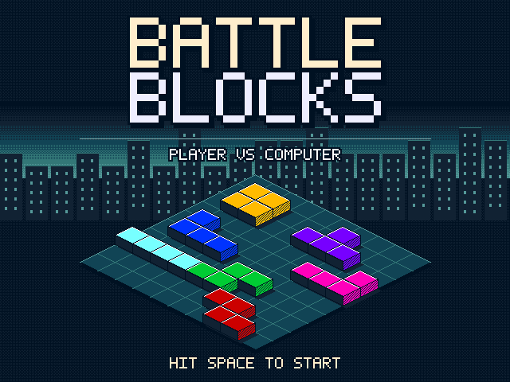
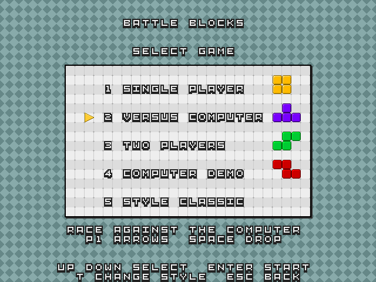
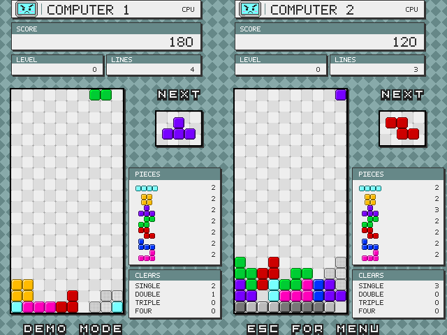
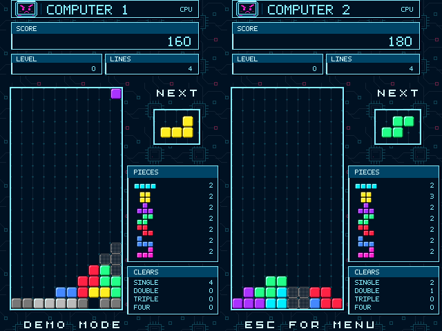

# Battle Blocks

Current version: **0.1.0** ([VERSION](VERSION)).

A falling-block battle game for the **Commander X16**. Play solo, challenge the computer, compete locally with a friend, or watch two computers battle in demo mode.

Clearing two, three, or four lines sends **one, two, or four garbage rows** to the opponent. Levels increase every ten cleared lines. Each board tracks its score, pieces, and single/double/triple/four-line clears.

Choose between **Light** and **Cyberpunk** themes, with bundled music and sound effects.

## Screenshots

Captured directly from the emulator at **640×480**. The splash uses exactly **16 colors**; both gameplay screenshots show real computer-versus-computer demo matches.

| Start screen | Menu |
| --- | --- |
|  |  |

| Light theme | Cyberpunk theme |
| --- | --- |
|  |  |

## Build and run

Requires **cc65** (`cl65`), **Python 3**, **Pillow**, and **NumPy**, plus the X16 emulator and a compatible ROM.

```sh
python3 -m pip install Pillow numpy
make run
```

The default emulator is `../x16-emulator/build/x16emu` and the default ROM is `../emulator/rom.bin`. Override their locations when needed:

```sh
make run EMU=/path/to/x16emu ROM=/path/to/rom.bin
```

Use `make` to build without launching, or `make clean` to remove generated game files.

Use `make dist` to create `build/CX16-BATTLEBLOCKS.ZIP`, containing 19 runtime
files (the program, graphics, and audio) plus `VERSION.txt`. Keep them together.

## Browser demo

The website runs the actual game using the official Commander X16 WebAssembly
emulator r49. It includes sound, fullscreen with integer pixel scaling, touch
controls, and a downloadable desktop package.

```sh
make site
python3 -m http.server 8000 --directory build/site
```

Open <http://localhost:8000>. The first site build downloads a checksum-verified
emulator archive; subsequent builds reuse `build/site-cache/`.

## GitHub Actions and releases

- `build.yml` compiles the game, checks the assets and package, and uploads the
  distribution on pushes to `master`/`develop`, pull requests, and manual runs.
- Tags named `vX.Y.Z` must match `VERSION`. A tag such as `v0.1.0` publishes a
  GitHub release with `CX16-BATTLEBLOCKS.ZIP` attached.
- `pages.yml` builds and checks the browser demo in Chromium, including real
  gameplay, keyboard input, theme changes, audio, and fullscreen rendering.
  Pull requests are checked; pushes to `master` deploy to GitHub Pages.

In repository **Settings → Pages → Build and deployment**, select
**GitHub Actions** as the source. The deployed demo will be available at
<https://ifilot.github.io/cx16-battleblocks/>.

To run the browser checks locally:

```sh
npm install --prefix build/browser-tools playwright@1.64.0
build/browser-tools/node_modules/.bin/playwright install chromium
NODE_PATH="$PWD/build/browser-tools/node_modules" node tests/check_site.cjs
```

`VERSION` supplies the release package and website metadata. After changing it,
run `make site` to regenerate both. Native AgentBridge tests also run when the
sibling desktop emulator and ROM are available.

## Controls

| Action | Player 1 | Player 2 (local battle) |
| --- | --- | --- |
| Move | Left / Right | A / D |
| Rotate | Up | W |
| Soft drop | Down | S |
| Hard drop | Space or 0 | Q |

In the menu, use Up/Down to select and Enter/Space to confirm. Number keys select an option; **T** switches themes. **Escape** returns from a game to the menu, and from the menu to the splash.

## Refresh screenshots

With the sibling emulator's AgentBridge Python API available:

```sh
make
python3 tools/capture_screenshots.py
```

Screenshots live in `docs/screenshots/`; production game assets remain in `assets/`.
