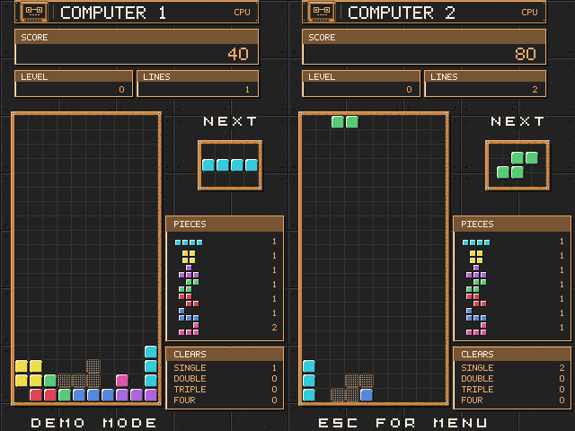
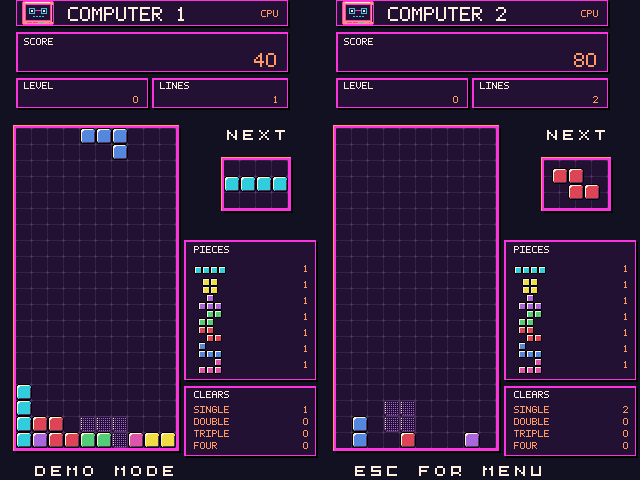
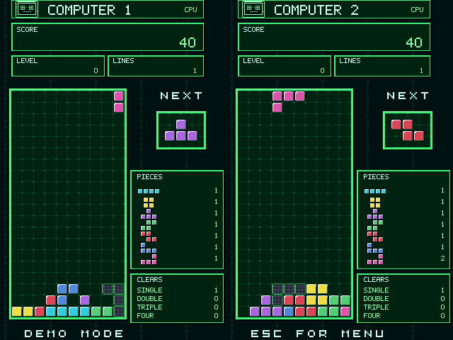
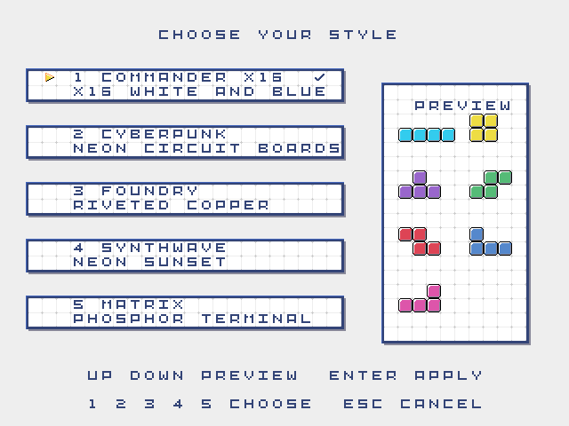

# Battle Blocks

[](https://github.com/ifilot/cx16-battleblocks/actions/workflows/build.yml)
[](VERSION)
[](LICENSE)

**Build your stack. Break theirs.** Battle Blocks is a falling-block game for
the **Commander X16**, with solo play, computer opponents, and local two-player
battles. Fit the pieces together, clear lines, and keep enough room for the next
piece. In a battle, your best clears also send trouble to the other board.

Five visual styles, music, and sound effects give each match its own atmosphere,
from the white-and-blue Commander X16 look to the green terminals of Matrix.

## Table of contents

- [Gameplay](#gameplay)
- [Game modes](#game-modes)
- [Five visual styles](#five-visual-styles)
- [Controls](#controls)
- [Play and build](#play-and-build)
- [Changelog](CHANGELOG.md)
- [License](#license)

## Gameplay

Every piece gives you a choice: clear a line now, or leave a gap and build toward
a bigger clear. The next-piece preview and landing shadow help you plan where
to put it. Your level rises every ten cleared lines, and the pieces fall faster
as the match goes on.

In battles, clearing several lines at once sends garbage rows to your opponent:
a double sends **one row**, a triple sends **two**, and a four-line clear sends
**four**. Each garbage row has a gap, but it pushes the existing stack upward.
Keep your board under control while trying to make the other player run out of
room first.

The score and level show your progress, while the piece and clear counters tell
the story of the match. Play for a better solo score, or see how long you can
hold out against an opponent.

## Game modes

| Mode | The challenge |
| --- | --- |
| **Single player** | Keep clearing lines as the pace increases and chase a higher score. |
| **Versus computer** | Outlast the computer while trading garbage attacks. |
| **Two players** | Share a keyboard and battle a friend on two separate boards. |
| **Computer demo** | Watch two computers build, clear, and attack each other. |

See a battle in motion: [Commander X16 gameplay](img/cx16-battleblocks-gameplay.gif)
or [Cyberpunk gameplay](img/cx16-battleblocks-cyberpunk-gameplay.gif).

## Five visual styles

All five styles support every game mode, with **Commander X16** as the default.
Open **Select style** to preview them
before choosing your favorite. Music and sound effects can be adjusted
independently in **Options**.

The gameplay screenshots show real computer battles captured from the emulator
at **640×480**.

### Commander X16

White surfaces, blue frames, and rainbow accents inspired by the Commander X16.


### Cyberpunk

Bright cyan frames and neon pieces against a quiet navy circuit backdrop.


### Foundry

Steel plates, riveted copper frames, and warm industrial lettering.



### Synthwave

Plum boards and pink neon frames against a flat dark background.



### Matrix

Phosphor-green lettering and sparse code columns surround the boards.



### Choose your style



## Controls

| Action | Player 1 | Player 2 (local battle) |
| --- | --- | --- |
| Move | Left / Right | A / D |
| Rotate | Up | W |
| Soft drop | Down | S |
| Hard drop | Space or 0 | Q |

Use Up/Down and Enter/Space in the menus, or number keys to select an option.
**T** switches styles in the main menu. During a match, **Escape** opens a
quit-confirmation dialog with **No** selected. Use the arrow keys and
Enter/Space to choose, **Y/N** for a direct answer, or **Escape** to cancel.
The dialog freezes the match and restores the previous pause state on cancel.

The computer's difficulty is shown above the pieces in the main menu. Press
Left/Right (or A/D) there to choose **Easy**, **Normal**, or **Hard**. Easy is
the default; the setting lasts for the session and applies to versus-computer
and demo modes.

| Computer difficulty | Time between moves/rotations | Wait before hard drop |
| --- | --- | --- |
| Easy | 200 ms | 1 second |
| Normal | 100 ms | 500 ms |
| Hard | 33 ms | 33 ms (the original speed) |

The hard-drop wait starts from the computer's last action. All levels use the
same placement search and normal gravity; slower levels give you more time to
react and limit how quickly the computer can place pieces and send attacks.

SNES controllers work alongside the keyboard: port 1 controls player 1 and
port 2 controls player 2 in local battles. Use the D-pad to move and soft-drop,
**Up or B/Y** to rotate, and **A/X** to hard-drop. **Start** pauses or resumes
the match; **Select** is ignored during gameplay. In menus, either controller
can navigate with the D-pad, confirm with **A/X or Start**, and go back with
**Select**.
`make run` and the browser demo enable both controller ports. When launching
the desktop emulator yourself, include `-joy1 -joy2`.

## Play and build

Extract the release ZIP into a folder on your Commander X16's SD card, open
that folder, and type `BOOT` to start the game. The executable is named
`AUTOBOOT.X16`; keep `GRAPHICS.DAT` and `AUDIO.BIN` alongside it. When these
files are in the SD card's root directory, the game also starts automatically
on boot. Compatible emulators can load and run `AUTOBOOT.X16` directly.
The browser demo also runs the actual game, with sound, fullscreen, and touch
controls. Its website includes
interactive previews of all five styles.

### Build from source

You need **cc65** (`cl65`), **Python 3**, **Pillow**, **NumPy**, an X16 emulator,
and a compatible ROM.

```sh
python3 -m pip install Pillow numpy
make run
```

The launcher looks for the emulator in the neighboring `x16-emulator` repository
or `~/emulator-linux/`. You can supply your own emulator and ROM paths:

```sh
make run EMU=/path/to/x16emu ROM=/path/to/rom.bin
```

`make` builds without launching. `make dist` creates the ready-to-copy package
at `build/CX16-BATTLEBLOCKS.ZIP`, containing just `AUTOBOOT.X16`,
`GRAPHICS.DAT`, `AUDIO.BIN`, and `VERSION.txt`. All five styles, music, and
sound effects are included. Individual generated assets stay in the source
build; graphics are streamed from one indexed bundle and audio is loaded from
one bank-aligned image. To record the gameplay GIFs, use `make demo`
with the AgentBridge emulator and Python client from the neighboring
`x16-emulator` repository.

### Run the browser demo locally

```sh
make site
python3 -m http.server 8000 --directory build/site
```

Open <http://localhost:8000>. Serve the generated `build/site/` directory over
HTTP so the emulator can load its files. The `site/` directory contains the
website source; the build adds the screenshots and game assets. The first build
downloads the official emulator r49 archive and caches it for later builds.

## License

Created by [Ivo Filot](https://github.com/ifilot). Battle Blocks is free software
under the [GNU General Public License v3.0 or later](LICENSE).
